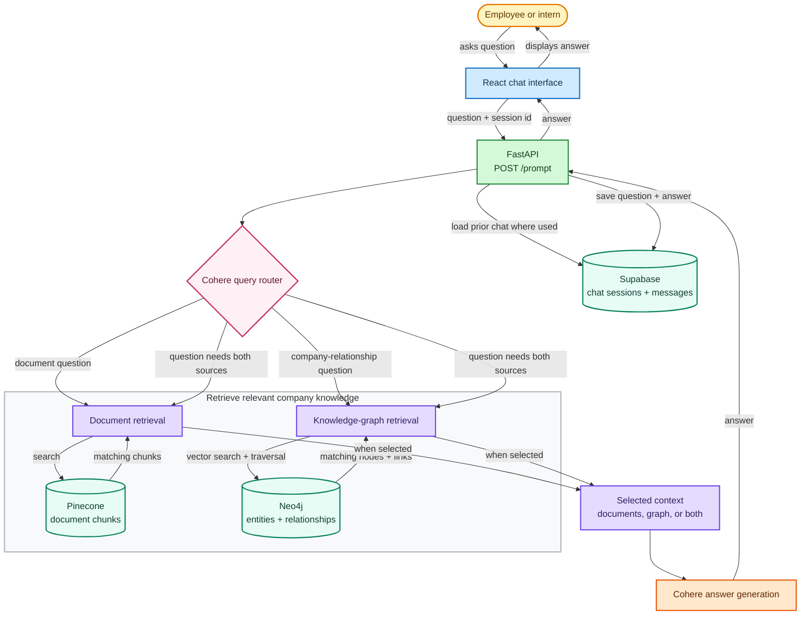
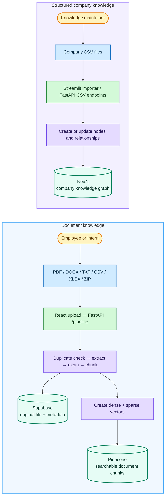
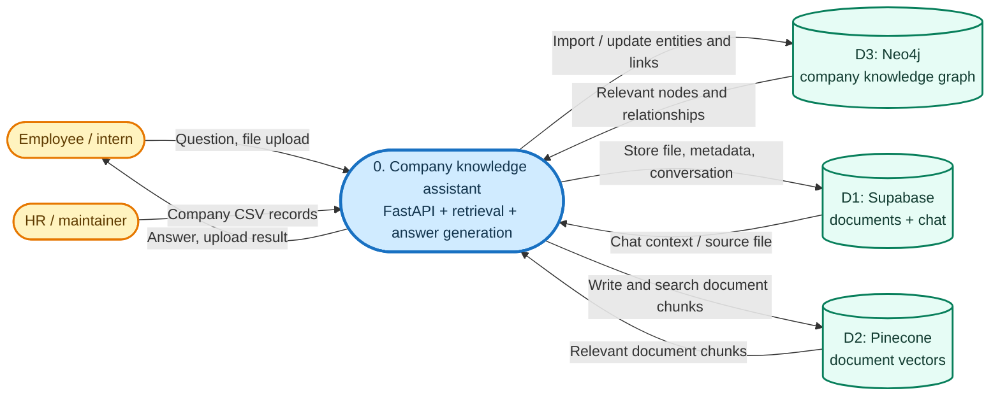
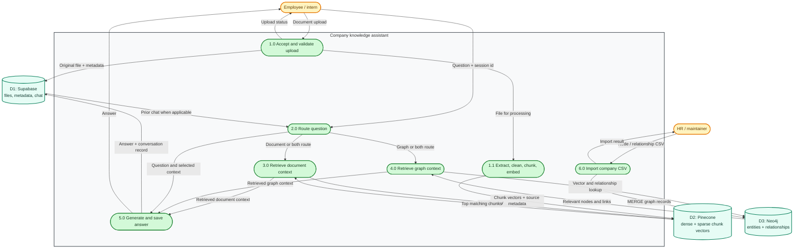

# Company Knowledge Graph RAG

A company knowledge assistant built with FastAPI, React/Vite, and Streamlit. Employees and interns can ask questions about company documents, policies, teams, people, and projects. The backend combines document retrieval with a Neo4j knowledge graph and uses Cohere to generate answers.

## Research paper

[Read the research paper](https://drive.google.com/file/d/1VaaaFgUY9IZW52n3ormaCemx8YvAp7Xc/view?usp=sharing)

## Features

- Upload PDF, DOCX, TXT, CSV, XLSX, and ZIP files for document retrieval
- Ask questions using retrieved document context, company-graph context, or both
- View and delete previous chat sessions
- Preview and download source files
- Import company entities and relationships from CSV files into Neo4j
- Explore the backend API through FastAPI's interactive documentation

## Project structure

```text
first_rag_project/
├── backend/
│   ├── api.py
│   ├── knowledge_graph/
│   ├── supabase_/
│   ├── chunking/
│   ├── embeddings.py
│   ├── file_reader.py
│   ├── pipeline.py
│   └── retrieve_docs.py
├── frontend_chatbot/
│   ├── src/
│   ├── index.html
│   ├── package.json
│   └── vite.config.js
├── frontend_CRUD/
│   └── streamlit_app.py
├── requirements.txt
└── README.md
```

## System design and architecture

The application has two separate jobs: answer questions and add knowledge. The diagrams below show each flow independently; arrows indicate the direction of requests or data.

### 1. Ask a question



The router chooses document retrieval, graph retrieval, or both. Retrieved context is passed to Cohere to produce the answer. Supabase is used for chat persistence; Pinecone and Neo4j are separate retrieval stores.

### 2. Add or update knowledge



Uploading a document does not populate the Neo4j graph. Graph data is maintained through CSV imports; document chunks are indexed separately in Pinecone.

## Data flow diagrams (DFD)

### Level 0 — Company knowledge assistant

This context diagram treats the application as one process and shows its external actors and data stores.



### Level 1 — Upload, retrieve, and answer



### Request and ingestion flows

- **Document ingestion:** `/pipeline` accepts a file. The backend checks for duplicate file content, stores new files and metadata in Supabase, extracts and cleans text, chunks it, and upserts dense and sparse vectors with source metadata into Pinecone.
- **Question answering:** `/prompt` classifies a question as document retrieval, knowledge-graph lookup, or both. It retrieves the relevant context, sends it to Cohere, and saves the exchange in the Supabase chat history.
- **Graph lookup:** Neo4j stores company nodes and relationships. The graph retrieval code uses vector similarity to select relevant nodes, traverses connected relationships, and returns graph context to the answer generator.
- **Company-data import:** The Streamlit CRUD tool and CSV endpoints add or update graph nodes and relationships. Document uploads do **not** automatically extract and populate the company graph.
- **Persistence:** Supabase stores uploaded files, document metadata, and chat data; Pinecone stores document-chunk vectors; Neo4j stores company entities, their embeddings, and relationships.

## Company use cases

- **Intern onboarding:** Ask where a team sits in the organization, who an intern reports to, which project a team works on, or where to find an onboarding or workplace policy. Graph questions depend on the corresponding current data having been imported; policy details can also be retrieved from uploaded documents.
- **Employee self-service:** Find policy guidance, understand team and department structure, identify project owners or reporting relationships, and ask questions that combine structured company information with details in documents.
- **HR and knowledge maintainers:** Import or refresh employee, intern, department, project, team, and policy records and their relationships using the CSV import endpoints.

Answers are only as current and complete as the documents and graph data supplied to the system. Company data may contain sensitive personal information; only use appropriately authorized data and protect the configured services and credentials.

## Dynamic knowledge graph

The graph represents company information as **nodes** (such as `Employee`, `Intern`, `Department`, `Team`, `Project`, and `Policy`) connected by typed **relationships** (such as `REPORTS_TO`, `HAS_EMPLOYEE`, `WORKS_ON`, and `PREPARED_BY`). The loader uses Neo4j `MERGE` operations keyed by entity name, so re-importing a row updates that node's properties rather than creating another node with the same name. Relationship imports likewise use `MERGE` to avoid duplicate relationships of the same type between matched nodes.

This makes the graph maintainable as company data changes: maintainers can import updated CSV records and new links, and graph retrieval can use those connections when answering questions. It is not an automatic synchronization system: someone must provide and import the changed data, and relationship imports require the referenced nodes to exist.

## Version control and data history

Git versions this repository's source code and documentation. The current Neo4j loader does **not** version company knowledge: it uses `MERGE` keyed by entity name and then `SET`s properties on that same node. A later CSV import therefore replaces the current property values; it does not preserve the old values, identify who changed them, or allow an as-of query or rollback. Relationship imports also merge links into the graph but do not record when a link became valid or ended.

To make the graph control previous and new knowledge versions, versioning must be added to the data model and import workflow. A recommended approach is:

1. Assign each import a unique `source_version` (such as a dataset release ID), an import timestamp, and source metadata. Keep the source CSV or snapshot so the import can be audited.
2. Preserve each prior entity and relationship state as an immutable version instead of overwriting it. Record validity metadata such as `valid_from`, `valid_to`, and `is_current`, or store versioned snapshots/events. On a changed record, close the previous version and create a new current version; unchanged records should not produce unnecessary revisions.
3. Apply an import as a validated batch. Check required fields, stable entity identifiers, and relationship endpoints before activating the new version. Keep an audit record of the source version and import outcome so a failed import cannot silently become the current state.
4. Make retrieval explicitly choose either the current version or a requested historical point in time. Version relationships as well as nodes so historical queries do not combine current links with old entity properties.
5. Support rollback by activating a previous snapshot/version, and verify it with tests for updates, unchanged records, new entities, removed entities/relationships, failed imports, current-state queries, and as-of queries.

These are recommended design requirements, **not implemented features** in this repository. For now, protect the source CSVs, record release/import details outside the graph, and back up/export Neo4j before important imports. Supabase file storage and Pinecone's vector index do not themselves provide graph-history or rollback semantics.

## Evaluations

There is no automated evaluation dataset or benchmark command in the repository at present. Before deployment or changes to retrieval, prompts, or graph data, build a small, approved test set from representative company questions. For each question, record the expected answer and the source document passage or graph entities/relationships that support it. Use anonymized or synthetic examples unless access to real company data is authorized.

The scores below are **randomly chosen placeholders for demonstration only**. They are not measurements, results, or claims about this project. Replace them with benchmark results before using this table to compare system performance.

Compare the requested approaches on the **same held-out questions and source data**. Use answer accuracy (correct answers divided by total questions) for an end-to-end comparison, and record retrieval/routing metrics to explain failures:

| Approach | What it evaluates | Recommended additional metric | Illustrative accuracy |
| --- | --- | --- | --- |
| Dense-index vanilla RAG | Dense document retrieval followed by answer generation | Supporting-chunk Recall@k | 76% |
| Hybrid-index vanilla RAG | Dense + sparse document retrieval followed by answer generation | Supporting-chunk Recall@k | 84% |
| Knowledge graph | Graph node/relationship retrieval followed by answer generation | Expected entity and relationship-path recall | 79% |
| Router (vanilla RAG + graph) | Route selection and end-to-end answering using the selected source or both | Route accuracy, alongside answer accuracy | 88% |

The repository contains no benchmark questions, expected answers, or recorded evaluation results, so these numbers must not be interpreted as measured accuracy. Replace the placeholders only after running the approaches against the same labeled test set; include the test-set size, date, retrieval `k`, model/configuration, and scoring rubric with the results. Grade correctness against an expected answer and verify factual claims against retrieved sources; report groundedness and latency separately rather than presenting them as answer accuracy.

Include questions about policies, onboarding, departments, reporting lines, projects, and questions that require combining documents with graph data. Review failures for missing or stale source data, incorrect routing, retrieval misses, and unsupported answers; re-run the same set after changes. These are recommended evaluation practices, not reported project scores.

## Prerequisites

Install the following before setting up the project:

- Python 3.10 or newer
- Node.js 18 or newer and npm
- A running or hosted Neo4j database
- Accounts and API credentials for Cohere, Pinecone, and Supabase

## Setup

### 1. Clone the repository

```powershell
git clone https://github.com/Saimohan80747/Policy_expert_rag_project.git
cd Policy_expert_rag_project
```

### 2. Create a Python environment

From the repository root, create and activate a virtual environment:

```powershell
python -m venv .venv
.\.venv\Scripts\Activate.ps1
```

If PowerShell blocks activation, run the following once for the current user and then activate the environment again:

```powershell
Set-ExecutionPolicy -ExecutionPolicy RemoteSigned -Scope CurrentUser
```

### 3. Install backend dependencies

```powershell
python -m pip install --upgrade pip
python -m pip install -r requirements.txt
python -m spacy download en_core_web_sm
```

### 4. Configure environment variables

Create `backend\.env` from the example file:

```powershell
Copy-Item backend\.env.example backend\.env
```

Open `backend\.env` and provide credentials for the connected services:

```dotenv
COHERE_API_KEY=your_cohere_api_key
SUPABASE_URL=https://your-project.supabase.co
SUPABASE_KEY=your_supabase_key
PINECONE_API_KEY=your_pinecone_api_key
NEO4J_URI=neo4j+s://your-instance.databases.neo4j.io
NEO4J_USER=neo4j
NEO4J_PASSWORD=your_neo4j_password
```

The backend also supports optional configuration for model names, Pinecone index and namespace, Neo4j vector search, chunking, retrieval limits, and allowed CORS origins. See `backend\config.py` for defaults and environment variable names. Keep `backend\.env` private. The backend loads it on startup and verifies the Neo4j connection.

### 5. Install frontend dependencies

In a new terminal, from the repository root:

```powershell
cd frontend_chatbot
npm install
```

## Run the application

Use two terminals from the repository root.

### Terminal 1: start the backend

```powershell
.\.venv\Scripts\Activate.ps1
cd backend
python -m uvicorn api:app --reload
```

The API is available at `http://127.0.0.1:8000`. Open `http://127.0.0.1:8000/docs` to view the Swagger UI.

### Terminal 2: start the chat frontend

```powershell
cd frontend_chatbot
npm run dev
```

Open the URL printed by Vite, usually `http://localhost:5173`.

The frontend is configured to call the backend at `http://127.0.0.1:8000`. If the backend runs on a different host or port, update `BASE_URL` in `frontend_chatbot\src\api.js`.

## API endpoints

| Method | Endpoint | Description |
| --- | --- | --- |
| `POST` | `/pipeline` | Upload and process a document |
| `POST` | `/ask` | Ask a knowledge-graph question |
| `POST` | `/prompt` | Ask a question in a chat session |
| `GET` | `/history` | List chat sessions |
| `GET` | `/history/{session_id}` | Get a session |
| `GET` | `/sessions/{session_id}` | Get messages for a session |
| `DELETE` | `/sessions/{session_id}` | Delete a chat session |
| `GET` | `/download/{file_name}` | Download a source file |
| `GET` | `/preview/{file_name}` | Preview a source file |
| `DELETE` | `/delete-document/{file_name}` | Delete a source document |
| `POST` | `/nodes/employee` | Import employee nodes from CSV |
| `POST` | `/nodes/intern` | Import intern nodes from CSV |
| `POST` | `/nodes/department` | Import department nodes from CSV |
| `POST` | `/nodes/subdepartment` | Import subdepartment nodes from CSV |
| `POST` | `/nodes/team` | Import team nodes from CSV |
| `POST` | `/nodes/project` | Import project nodes from CSV |
| `POST` | `/nodes/policy` | Import policy nodes from CSV |
| `POST` | `/relationships/department-subdepartment` | Import department-to-subdepartment links from CSV |
| `POST` | `/relationships/subdepartment-team` | Import subdepartment-to-team links from CSV |
| `POST` | `/relationships/team-employee` | Import team-to-employee links from CSV |
| `POST` | `/relationships/employee-employee` | Import employee reporting links from CSV |
| `POST` | `/relationships/intern-employee` | Import intern reporting links from CSV |
| `POST` | `/relationships/policy-employee` | Import policy-owner links from CSV |
| `POST` | `/relationships/teammate` | Import teammate links from CSV |
| `POST` | `/relationships/team-project` | Import team-to-project links from CSV |

### Optional: start the CSV graph importer

```powershell
.\.venv\Scripts\Activate.ps1
streamlit run frontend_CRUD\streamlit_app.py
```

Start the API first. The importer calls the graph CSV endpoints on the API.

## Troubleshooting

- **`Missing Neo4j credentials in .env`**: confirm that `backend\.env` exists and contains `NEO4J_URI`, `NEO4J_USER`, and `NEO4J_PASSWORD`.
- **Neo4j connectivity errors**: make sure the database is running, the URI is reachable, and the credentials are correct.
- **Frontend cannot reach the API**: start the backend first and confirm that it is listening on port `8000`.
- **Missing Python module**: activate `.venv` and run `python -m pip install -r requirements.txt` from the repository root.
- **Frontend dependency errors**: remove `frontend\node_modules` only if needed, then run `npm install` again.

## Security

Never commit API keys, database passwords, uploaded documents, or other secrets. Use `backend\.env` for local credentials and keep it out of version control.
